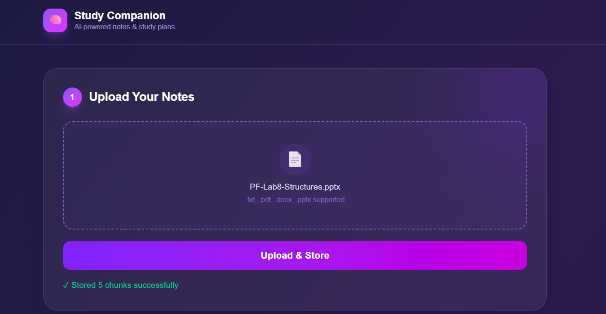

# 📚 AI_Study_companion — Intelligent RAG Study Companion

> **Transform raw notes into structured, high-impact study plans in seconds using low-latency vector search and hyper-fast LLM generation.**

---

## 🌟 Overview

**AI_Study_companion** is a cutting-edge study assistant engineered to solve information overload for students and self-learners. By leveraging Retrieval-Augmented Generation (RAG), AI_Study_companion ingests your course syllabus, lecture notes, or reference documents, breaks them into rich semantic chunks, and indexes them in a cloud vector database. 

When you ask a question or request a study path, the system performs real-time semantic retrieval to deliver accurate, context-aware, and structured study plans tailored specifically to your learning materials.

---
<div align="center">

## 📸 Application Preview



*Upload course documents, search specific topics, and instantly get structured JSON study pathways.*

</div>


## ✨ Key Features

* 📄 **Multi-Format Document Ingestion:** Seamlessly upload PDFs, pptx, docx & txt documents to extract core curriculum details.
* ✂️ **Smart Context Chunking:** Dynamically splits large documents into optimized 200–500 token passages, preserving paragraph integrity and semantic context.
* 🔍 **Real-Time Vector Search:** Connects directly with cloud vector indexes to fetch the exact context needed for your queries.
* ⚡ **Ultra-Fast LLM Generation:** Powered by high-speed inference engines to output clean, structured, and actionable study plans in formatted JSON.
* 🎯 **Zero Hallucination Focus:** Generates study material strictly grounded in your provided documents and syllabus.
* 🎨 **Sleek & Responsive UI:** Built with modern web standards for a smooth, distraction-free study experience.

---

> **"Stop drowning in endless lecture slides. Let vector intelligence extract the core of your curriculum."** 🚀

---

## 🛠️ Tech Stack

* **Frontend & Runtime:** [Next.js](https://nextjs.org/) (Node.js Environment)
* **Vector Database:** [Qdrant Cloud Cluster](https://qdrant.tech/)
* **LLM Engine:** [Groq Cloud API](https://groq.com/) (High-Speed LLM Inference)
* **Embeddings & Vector Processing:** Dense Vector Embeddings Pipeline
* **Styling & UI Components:** Modern Responsive CSS / UI Library

---

## 🚀 How to Run This Project

Follow these steps to run **AI_Study_companion** locally on your machine.

### 1. Prerequisites

Ensure you have the following installed and set up:
* **Node.js** (v18.x or higher)
* **npm** or **yarn**
* A **Qdrant Cloud** cluster account & API Key
* A **Groq Cloud API** key

### 2. Clone the Repository

```bash
git clone [https://github.com/your-username/AI_Study_companion.git](https://github.com/your-username/AI_Study_companion.git)
cd AI_Study_companion

### 3. Install Dependencies

npm install
# or
yarn install

### 4. Configure Environment Variables

# Qdrant Cloud Credentials
NEXT_PUBLIC_QDRANT_URL=[https://your-qdrant-cluster-url.cloud.qdrant.io](https://your-qdrant-cluster-url.cloud.qdrant.io)
QDRANT_API_KEY=your_qdrant_api_key

# Groq Cloud API Key
GROQ_API_KEY=your_groq_api_key

### 5. Run the Development Server

npm run dev
# or
yarn dev

Open http://localhost:3000 in your browser to start exploring AI_Study_companion.

```

*Empower your intelligence, study smarter, learn faster, and master anything with AI Study-Companion. ✨*
